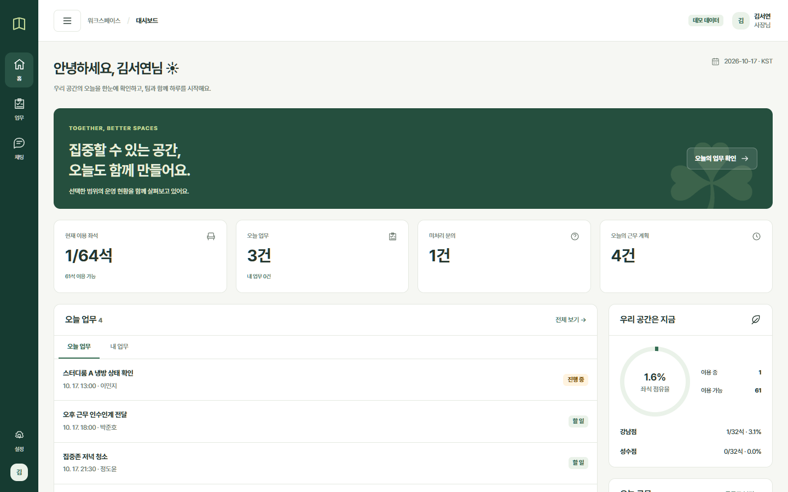
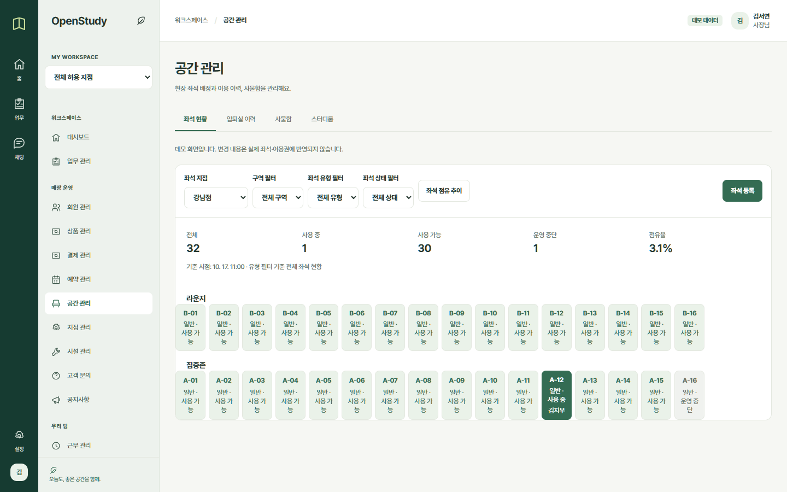
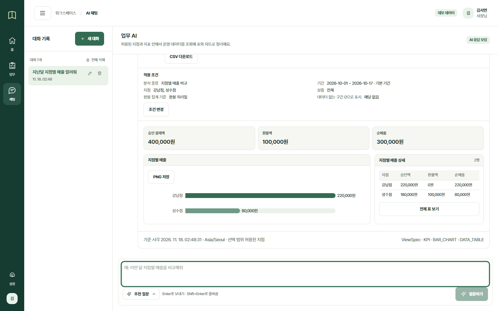
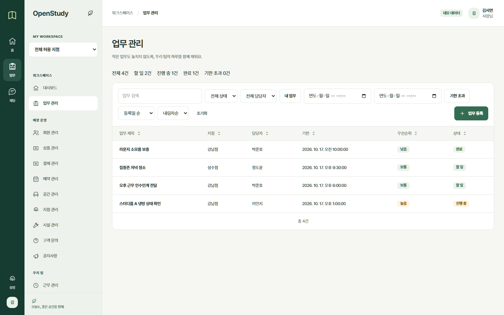
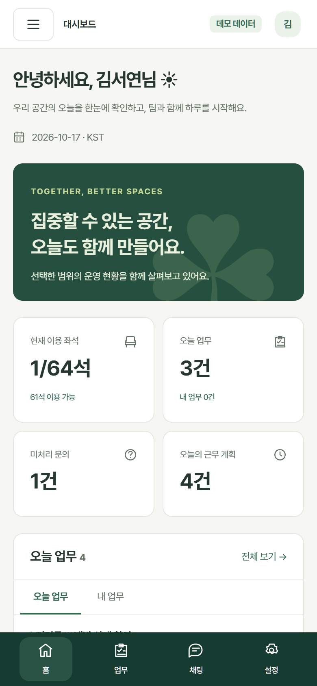

# OpenStudy Frontend

스터디카페 지점 운영 백오피스 **OpenStudy**의 웹 화면입니다.
사장님·지점 관리자·직원이 한 곳에서 지점 현황을 확인하고, 고객·이용권·결제, 좌석·룸·사물함, 업무·채팅, 근무·근태, 매출과 AI 분석을 처리합니다.

> 프로젝트 전체 소개는 [OpenStudy 대표 저장소](https://github.com/OpenStudyService/OpenStudy)를 참고하세요.
> API 서버는 [OpenStudy-Backend](https://github.com/OpenStudyService/OpenStudy-Backend), AWS 인프라는 [OpenStudy-Infra](https://github.com/OpenStudyService/OpenStudy-Infra)에서 관리합니다.



| 좌석 배치도 | AI 자연어 분석 |
|---|---|
|  |  |
| **업무 관리** | **모바일 홈** |
|  |  |

<sub>화면은 데모 모드(MSW 가상 데이터)에서 캡처했습니다.</sub>

## 기술 스택

| 구분 | 사용 기술 |
|---|---|
| 기반 | React 19, TypeScript 5.9(strict), Vite 8 |
| 상태·데이터 | TanStack Query(서버 상태), Zustand(UI 상태), Zod(데이터 계약) |
| UI | Radix UI, 자체 디자인 토큰(포레스트·네이비·샌드 테마) |
| API | OpenAPI 생성 타입, fetch 클라이언트(CSRF·오류·취소 처리) |
| 데모 | MSW(Mock Service Worker) 기반 가상 서버 |
| 테스트 | Vitest·Testing Library, Playwright(Chrome) |
| 배포 | GitHub Actions → Amazon S3 + CloudFront |

## 주요 화면

| 영역 | 화면 |
|---|---|
| 계정 | 로그인, 초대 수락·승인 대기, 비밀번호 재설정, 프로필 |
| 홈 | 이용 좌석·오늘 업무·미처리 문의·근무 계획 카드, 좌석 점유율 |
| 협업 | 업무·체크리스트, 채널·DM·스레드, 업무와 대화 연결 |
| 고객·거래 | 회원·보유 이용권, 상품·요율, 결제·환불, 이용 이력 |
| 공간 | 좌석 배치도·입퇴실, 스터디룸 예약 달력·목록, 사물함 |
| 운영 | 시설·점검, 고객 문의, 공지 |
| 인력 | 주간 근무표, 출퇴근·휴게, 근태 정정, 휴가, 대체근무 |
| 분석 | 지점별 매출, AI 자연어 질문 → 표·막대·선 차트 |
| 관리 | 지점, 직원·초대·권한 프리셋, 설정 |

## 설계 포인트

- **명시적 화면 갱신**: 실시간 푸시(SSE·polling) 대신 메뉴 진입·재클릭·새로고침·조건 변경 시 다시 조회합니다. 본인이 저장한 결과는 즉시 반영하고, 권한·충돌 검증은 서버가 담당합니다. [명시적 화면 갱신 정책](docs/design/data-refresh-policy.md)
- **서버 상태 단일화**: 조회는 TanStack Query, 변경은 mutation으로 처리하고 서버 응답 후 목록·홈·연결 카드를 다시 조회합니다. 업무 데이터를 클라이언트 저장소에 중복 보관하지 않습니다.
- **주소로 화면 복원**: `/app/:scope/...`의 상세·편집·스레드·탭·검색·필터·정렬·페이지·날짜를 URL에서 복원합니다.
- **안전한 입력**: 민감 명령은 멱등 키와 버전을 함께 보내고, 409 충돌이나 실패 시 입력을 보존한 뒤 최신 값을 확인해 다시 저장할 수 있습니다.
- **반응형 3단 탐색**: 1100px 이상 전체 탐색, 641~1099px 보조 서랍, 640px 이하 하단 탐색과 모바일 대화 구조.
- **접근성**: 본문 건너뛰기, 오류 레이블 연결, 패널 포커스 복귀, 모션 감소를 적용했습니다.
- **live / demo 빌드 분리**: 실제 API 빌드에는 MSW·데모 코드·소스맵이 섞이지 않도록 산출물의 모듈 출처까지 검사합니다.

## 실행하기

Node.js **24.19.0**, npm **11.10.1**에서 검증했습니다.

```sh
npm ci
npm run dev        # 데모 모드(MSW), 백엔드 없이 실행
npm run dev:live   # 실제 /api 서버 연결
```

표시되는 localhost 주소로 접속합니다. 개인별 API 주소 등은 `.env.local`, `.env.mock.local`, `.env.live.local`에 작성하며 커밋하지 않습니다(`.env.example` 참고).

| 명령 | 동작 |
|---|---|
| `npm run build` | 실제 API 배포 빌드(`dist/`)와 산출물 검사 |
| `npm run build:demo` | 데모 빌드(`dist-demo/`)와 산출물 검사 |
| `npm run check` | strict 타입 검사, ESLint, Vitest |
| `npm run test:e2e` | Chrome에서 사용자 흐름·반응형 검증(데모 모드) |
| `npm run test:builds` | live·demo 두 배포 결과의 동작·모드 분리 검증 |

<details>
<summary>그 밖의 명령</summary>

| 명령 | 동작 |
|---|---|
| `npm run preview` | 마지막 빌드 결과 미리보기 (데모: `npm run preview -- --outDir dist-demo`) |
| `npm run check:build:live` / `check:build:mock` | 기존 빌드 결과의 모드·출처 검사 |
| `npm run test:e2e:<기능>:live` | 실제 Backend·MySQL에 연결한 기능별 브라우저 검증 ([절차](docs/testing/)) |
| `npm run test:e2e:<기능>:mock` | 같은 기능의 MSW 회귀 |
| `npm run api:foundation` | 인접 `openstudy-backend`의 기반 OpenAPI에서 타입 생성 |
| `npm run api:generate` | Zod·폼 정의 → OpenAPI → TypeScript 타입 재생성 |

</details>

## 데모 체험

로그인 화면의 **사장님으로 체험 / 직원으로 체험** 버튼으로 시작합니다. 앱 상단에 **데모 데이터** / **실제 API 연결** 표시로 모드를 구분합니다.

- 계정: `owner@openstudy.test`, `minji@openstudy.test`, `junho@openstudy.test`, `yujin@openstudy.test`, `doyun@openstudy.test` + **8자 이상 임의 비밀번호**
- 지점: 강남점·성수점. 기준 시각 **2026-10-17 11:00 KST**부터 흐르는 시계
- 사용자 메뉴 → 데모·검증 도구에서 역할과 API 시나리오를 바꿀 수 있습니다.
- 데모 데이터는 탭의 sessionStorage에만 저장되며, 설정의 **가상 데이터 초기화**로 되돌립니다.
- 비밀번호 재설정은 `/password-reset#token=demo-password-reset`로 체험합니다(한 번 사용하면 만료).

**추천 흐름**: 강남점 업무 등록 → 담당 박준호 지정 → 상세에서 운영 채널에 공유 → 설정에서 직원 박준호로 전환 → 스레드에 보고 → 연결 업무 완료 → 홈·목록 카드 확인.

AI 데모는 **지난달 지점별 매출** 질문을 지원합니다. SQL이나 HTML을 실행하지 않고 JSON 결과로 표·차트를 그립니다.

## 실제 서버 연결과 검증 범위

- 고객·결제·좌석·룸·사물함·업무·채팅·초대·근무표·근태·매출 등 주요 기능은 실제 Backend와 MySQL에 연결한 Playwright 시나리오로 검증했습니다. 기능별 절차와 결과는 [docs/testing](docs/testing/)에 있습니다.
- `live` 모드는 API 실패를 데모 데이터로 대체하지 않습니다. 데이터가 없으면 빈 상태를, 미구현(404/501)·연결 오류는 안내와 재시도 버튼을, 인증·권한 오류(401/403)는 별도 처리로 보여 줍니다.
- 결제는 **Mock 결제**이며 실제 금전 이동이 없습니다.
- 아직 남은 항목:
  - AI 대화·상태·취소·확인 선택의 실제 API 연결 ([#32](https://github.com/OpenStudyService/OpenStudy-Frontend/issues/32))
  - 실제 API·DB를 연결한 전체 업무 회귀 ([#36](https://github.com/OpenStudyService/OpenStudy-Frontend/issues/36))
  - 데스크톱 반응형·이탈 경고·기본 접근성 최종 점검 ([#35](https://github.com/OpenStudyService/OpenStudy-Frontend/issues/35))
- 고객이 QR로 직접 입퇴실하는 고객용 화면은 범위 밖입니다. 좌석 화면의 직원용 배정·퇴실은 예외 지원 기능입니다.

## 코드 구조

```text
src/app/             초기화, 라우트, 공통 레이아웃, 테마·UI 상태
src/features/        기능별 화면(인증, 홈, 업무, 채팅, 고객, 결제, 좌석, 근태, 분석, 설정 …)
src/shared/api/      fetch·CSRF·오류·취소, 생성 타입
src/shared/domain/   Zod 데이터 계약, 권한 함수, 화면·폼 정의
src/shared/ui/       디자인 컴포넌트, SVG 아이콘·일러스트
src/mocks/           seed, 탭 세션 원장, 승인 규칙, MSW HTTP
tests/               Playwright 시나리오(데모·실서버), 화면 크기·테마 캡처
docs/                API 인계, 설계, 테스트 절차, 개발 기록
```

## 배포

GitHub Actions가 검사와 live 빌드 후 비공개 Amazon S3에 게시하고, Amazon CloudFront가 HTTPS로 제공합니다. 인프라는 OpenStudy-Infra의 `terraform/frontend`가 관리합니다. 처음 생성·변수 등록·전체 삭제는 [자동 배포 순서](docs/deployment.md)를 따릅니다.

## 문서

| 문서 | 내용 |
|---|---|
| [docs/api](docs/api/README.md) | API 인계 계약 |
| [docs/design](docs/design/data-refresh-policy.md) | 화면 갱신 정책 등 설계 결정 |
| [docs/traceability.md](docs/traceability.md) | 요구사항 ↔ 화면 추적표 |
| [docs/verification.md](docs/verification.md) | 데모 모드 검증 기록 |
| [docs/testing](docs/testing/) | 실서버 연결 검증 절차 |
| [docs/development-log](docs/development-log/) | 날짜별 작업·의사결정 기록 |

## GitHub 이슈 관리 규칙

이슈 제목은 `[F01]`, `[M1]` 같은 접두사 없이 작업명을 그대로 씁니다. 식별은 이슈 번호, 개발 단계는 Milestone, 유형·진행 상태는 Label과 Projects로 관리합니다. 다른 저장소 의존성은 `owner/repo#번호`나 링크로 연결합니다.
