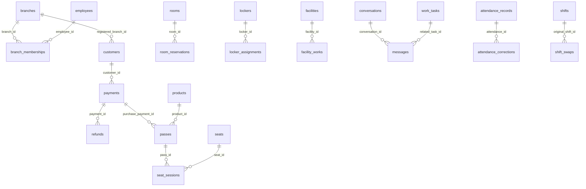

# OpenStudy 조회 도메인 사전

근거 Backend: `898ba3231e8e50209a7b891e177b4b742576a0d0`. 실제 DB 접속·조회는 수행하지 않았다. 커밋된 DDL과 OpenAPI의 구조를 확인했다. 모든 화면 데이터는 데모 전용 고정 fixture이며 다른 탭의 원장과 동기화되지 않는다.

- [DDL V1](https://github.com/OpenStudyService/OpenStudy-Backend/blob/898ba3231e8e50209a7b891e177b4b742576a0d0/src/main/resources/db/migration/V1__init_schema.sql)
- [고객 등록 지점 V2](https://github.com/OpenStudyService/OpenStudy-Backend/blob/898ba3231e8e50209a7b891e177b4b742576a0d0/src/main/resources/db/migration/V2__customer_branch_and_memo.sql)
- [OpenAPI](https://github.com/OpenStudyService/OpenStudy-Backend/blob/898ba3231e8e50209a7b891e177b4b742576a0d0/docs/design/foundation/openapi.json)
- [매출 정책](https://github.com/OpenStudyService/OpenStudy-Backend/blob/898ba3231e8e50209a7b891e177b4b742576a0d0/docs/db/ADR-M9-001.md)

## 도메인별 원본과 준비 상태

### 01. 지점·직원

지점, 소속과 초대. **원본 조회 API 있음 · 자연어 집계 연결 예정**

- `branches`: `id`, `name`, `status`
- `employees`: `id`, `name`, `status`
- `branch_memberships`: `employee_id`, `branch_id`, `status`
- `employee_invitations`: `id`, `branch_id`, `status`, `expires_at`

관계:

- branch_memberships.branch_id → branches.id
- branch_memberships.employee_id → employees.id
- employee_invitations.branch_id → branches.id

API 계약 확인:

- `/branches`: OpenAPI 정의 있음
- `/employees`: OpenAPI 정의 있음
- `/invitations`: OpenAPI 정의 있음

권한/노출 정책: OWNER 전용 시연 · 도메인별 AI 권한 정책 미확정.

- **org-active** — 지점별 활성 직원 수를 보여줘: 활성 소속과 활성 직원의 지점별 DISTINCT 직원 수. OWNER는 소속 레코드가 있을 때만 포함.
- **org-pending** — 승인 대기 소속과 초대 현황을 보여줘: 소속 PENDING 및 초대 PENDING/ACCEPTED, 만료되지 않은 초대를 별도 종류로 UNION. 중복 직원 합산 안 함.

### 02. 회원

등록 추이와 회원 상태. **원본 조회 API 있음 · 자연어 집계 연결 예정**

- `customers`: `id`, `member_no`, `name`, `status`, `registered_at`, `registered_branch_id`

관계:

- customers.registered_branch_id → branches.id (V2)

API 계약 확인:

- `/customers`: OpenAPI 정의 있음

권한/노출 정책: OWNER 전용 시연 · 이름은 가상·마스킹, 연락처 제외.

- **customers-new** — 이번 달 신규 회원 추이를 보여줘: 등록일의 KST 날짜별 신규 회원 수. 등록 지점 없는 기존 회원의 지점 집계 귀속은 별도 협의.
- **customers-restricted** — 이용 제한 회원 목록을 보여줘: customers.status = RESTRICTED. 연락처·메모·상태 변경 사유 제외.

### 03. 상품·이용권

판매 상품과 만료 예정. **원본 조회 API 있음 · 자연어 집계 연결 예정**

- `products`: `id`, `name`, `kind`, `sale_status`, `price_krw`
- `product_branches`: `product_id`, `branch_id`
- `payments`: `id`, `branch_id`, `product_id`, `purpose`, `status`, `approved_at`, `issued_pass_quantity`
- `refunds`: `id`, `payment_id`, `refunded_at`
- `passes`: `id`, `customer_id`, `purchase_branch_id`, `kind`, `status`, `expires_at`, `remaining_minutes`, `remaining_credit_krw`

관계:

- product_branches.product_id → products.id
- payments.product_id → products.id
- refunds.payment_id → payments.id
- passes.customer_id → customers.id

API 계약 확인:

- `/products`: OpenAPI 정의 있음
- `/passes`: OpenAPI 정의 있음

권한/노출 정책: OWNER 전용 시연 · 기간권 시작 전은 만료 예정에서 제외.

- **products-active** — 판매 중 상품의 유형별 현황을 보여줘: 판매 중 상품을 판매 지점별 DISTINCT products.id로 집계. 전체 지점 선택 시 같은 상품의 지점 중복 제거가 필요하며, 이 fixture의 상품은 서로 다름.
- **passes-expiring** — 7일 안에 만료되는 이용권을 보여줘: 활성 이용권 중 expires_at이 기준 시각 이후이고 종료 경계 미만. 시작 전·만료 없음 제외.
- **products-top5** — 지난달 가장 잘 팔린 이용권 TOP 5를 보여줘: 이용권 결제만 대상. 상품별 승인 발급 수량에서 기간 내 환불 수량을 차감한 순판매량. 상품별로 지점 값을 합한 뒤 순판매량 내림차순 TOP 5. 이 fixture는 5개 상품으로 고정.

### 04. 결제·환불·매출

지점별 수치와 거래 근거. **결제 원본 API 있음 · M9 집계·M10 엔진 연결 예정**

- `payments`: `id`, `branch_id`, `amount_krw`, `purpose`, `status`, `approved_at`
- `refunds`: `id`, `payment_id`, `processing_branch_id`, `amount_krw`, `refunded_at`

관계:

- refunds.payment_id → payments.id
- payments.branch_id → branches.id

API 계약 확인:

- `/payments`: OpenAPI 정의 있음

권한/노출 정책: ai:read + 대상 모든 지점의 sales:read · 거래 상세에는 payments:read 추가.

- **sales-net** — 지난달 지점별 순매출을 보여줘: 승인액 − 환불액. 이용권·룸·사물함 모두 포함. 환불 처리일 기준, 원결제 지점 귀속. 환불 이후 상태가 REFUNDED인 승인 원거래도 승인액에 포함.
- **sales-refunds** — 이번 달 환불 내역을 보여줘: refunded_at이 기간에 속하는 환불 원장. 처리 지점이 달라도 payments.branch_id로 귀속.

### 05. 좌석·입퇴실

현재 이용과 완료 세션. **원본·좌석 현황 API 있음 · 자연어 연결 예정**

- `seats`: `id`, `branch_id`, `seat_no`, `zone`, `status`
- `seat_sessions`: `id`, `branch_id`, `seat_id`, `status`, `effective_checked_in_at`, `effective_checked_out_at`, `billed_minutes`, `billed_krw`

관계:

- seat_sessions.seat_id + branch_id → seats.id + branch_id

API 계약 확인:

- `/seats/occupancy`: OpenAPI 정의 있음
- `/seat-sessions`: OpenAPI 정의 있음

권한/노출 정책: OWNER 전용 시연 · 완료 이용은 유효 퇴실 시각 기준.

- **seats-now** — 현재 지점별 좌석 이용 현황을 보여줘: 활성 좌석 세션 기준 점유 좌석 수. 이용 가능 + 이용 중 + 사용 불가 = 전체 좌석. 점유율 분모 정책은 정본 API와 대조.
- **seats-completed** — 오늘 완료된 좌석 이용 내역을 보여줘: 유효 퇴실 시각이 오늘인 완료 세션. 보정된 시각을 사용하고 청구분은 billed_minutes를 별도로 표시.
- **seats-heatmap** — 지난주 요일·시간대별 좌석 이용 건수를 보여줘: 유효 입실 시각의 KST 요일·시간대별 COUNT(seat_sessions.id). 입실 시작 건수이며 동시 점유율이나 실제 혼잡도 예측이 아님.

### 06. 스터디룸·예약

오늘의 일정과 주간 예약. **DB 정의 있음 · 정본 조회 API 준비 여부 별도 확인**

- `rooms`: `id`, `branch_id`, `name`, `capacity`
- `room_reservations`: `id`, `room_id`, `branch_id`, `start_at`, `end_at`, `status`

관계:

- room_reservations.room_id + branch_id → rooms.id + branch_id

API 계약 확인:

- `/rooms`: 이 커밋의 OpenAPI 정의 없음
- `/room-reservations`: 이 커밋의 OpenAPI 정의 없음

권한/노출 정책: OWNER 전용 시연 · 취소·결제 실패 제외, 예약 시작일 기준.

- **rooms-today** — 오늘의 스터디룸 예약을 보여줘: 오늘과 시간 구간이 겹치는 예약. 취소·결제 실패 제외, 구간 겹침은 start < dayEnd AND end > dayStart.
- **rooms-week** — 이번 주 룸별 예약 건수를 보여줘: 예약 시작일이 이번 주인 예약의 COUNT. 취소·결제 실패 제외. 주 시작 월요일.

### 07. 사물함

배정 현황과 기간 종료. **DB 정의 있음 · 정본 조회 API 준비 여부 별도 확인**

- `lockers`: `id`, `branch_id`, `locker_no`, `status`
- `locker_assignments`: `id`, `locker_id`, `start_date`, `end_date`, `status`, `returned_at`

관계:

- locker_assignments.locker_id → lockers.id

API 계약 확인:

- `/lockers`: 이 커밋의 OpenAPI 정의 없음

권한/노출 정책: OWNER 전용 시연 · 배정 종료일 기준, 회원 연락처 제외.

- **lockers-status** — 사물함 배정 현황을 보여줘: 활성 배정의 사물함 수와 사용 불가 상태를 구분. 사물함당 중복 배정 없이 집계.
- **lockers-ending** — 7일 안에 배정 기간이 끝나는 사물함을 보여줘: 미반납 배정의 end_date가 10월 17일 이상·24일 미만. DATE 종료일의 포함 규칙은 업무 계약 확인.

### 08. 시설·점검

점검 지연과 진행 작업. **원본·시설 요약 API 있음 · 자연어 연결 예정**

- `facilities`: `id`, `branch_id`, `name`, `status`, `inspection_interval_days`, `last_inspected_on`
- `facility_works`: `id`, `facility_id`, `kind`, `status`, `opened_at`, `completed_at`

관계:

- facility_works.facility_id → facilities.id

API 계약 확인:

- `/facilities`: OpenAPI 정의 있음
- `/facilities/summary`: OpenAPI 정의 있음

권한/노출 정책: OWNER 전용 시연 · 다음 점검일은 최근 점검일 + 점검 주기.

- **facilities-overdue** — 점검 예정일이 지난 시설을 보여줘: last_inspected_on + inspection_interval_days < KST 오늘. 최초 점검일 없음은 별도 미점검 상태로 다룸.
- **facilities-open** — 진행 중인 시설 작업을 보여줘: facility_works.status = IN_PROGRESS, facility_id로 지점 귀속.

### 09. 업무·채팅

기한과 채널 업무 공유. **업무 API 있음 · 채팅은 계약 정의, 실제 연결 후속**

- `work_tasks`: `id`, `branch_id`, `title`, `status`, `due_at`, `completed_at`
- `messages`: `id`, `conversation_id`, `related_task_id`, `kind`, `sent_at`
- `conversations`: `id`, `branch_id`, `kind`, `name`
- `conversation_members`: `conversation_id`, `employee_id`

관계:

- messages.related_task_id → work_tasks.id
- messages.conversation_id → conversations.id
- conversation_members.conversation_id → conversations.id

API 계약 확인:

- `/tasks`: OpenAPI 정의 있음
- `/channels/{id}/messages`: OpenAPI 정의 있음

권한/노출 정책: OWNER 전용 시연 · 현재 참여 채널만, DM 본문 조회 제외.

- **tasks-overdue** — 기한이 지난 미완료 업무를 보여줘: due_at < asOf AND status != DONE. 단순 날짜 비교가 아닌 시각 기준.
- **chat-task-shares** — 현재 채널의 업무 공유 메시지를 보여줘: 현재 conversation_id의 TASK_CARD만 조회. 참여 여부·업무 원본 접근을 각각 확인.

### 10. 문의·공지

미답변 문의와 게시 공지. **계약 정의 확인 · 실제 구현 준비 상태 별도 확인**

- `inquiries`: `id`, `branch_id`, `subject`, `status`, `created_at`, `answered_at`
- `announcements`: `id`, `title`, `target`, `status`, `is_pinned`, `published_at`
- `announcement_branches`: `announcement_id`, `branch_id`

관계:

- announcement_branches.announcement_id → announcements.id

API 계약 확인:

- `/inquiries`: OpenAPI 정의 있음
- `/notices`: OpenAPI 정의 있음

권한/노출 정책: OWNER 전용 시연 · 문의 본문·답변 원문 제외.

- **support-unanswered** — 아직 답변하지 않은 문의를 보여줘: answered_at IS NULL인 미종결 문의. 문의·답변 본문과 연락처는 결과에 포함하지 않음.
- **notices-live** — 현재 게시 중인 지점 공지를 보여줘: 게시 상태와 게시 시각을 확인하고 announcement_branches 또는 전체 공지 대상으로 조회.

### 11. 근무·근태

근무표와 정정 신청. **DB 정의 있음 · 정본 조회 API 준비 여부 별도 확인**

- `shifts`: `id`, `employee_id`, `branch_id`, `starts_at`, `ends_at`, `status`
- `attendance_records`: `id`, `employee_id`, `branch_id`, `clock_in_at`, `clock_out_at`
- `attendance_corrections`: `id`, `attendance_id`, `correction_kind`, `status`, `created_at`

관계:

- attendance_corrections.attendance_id → attendance_records.id
- shifts.employee_id + branch_id → branch_memberships.employee_id + branch_id

API 계약 확인:

- `/shifts`: 이 커밋의 OpenAPI 정의 없음
- `/attendance-corrections`: 이 커밋의 OpenAPI 정의 없음

권한/노출 정책: OWNER 전용 시연 · 정정 사유 원문 제외.

- **shifts-week** — 이번 주 직원 근무표를 보여줘: 이번 주와 구간이 겹치는 취소되지 않은 근무. 직원 소속 지점이 아닌 shifts.branch_id 사용.
- **attendance-pending** — 처리 대기 근태 정정 신청을 보여줘: REQUESTED 신청만 조회하고 attendance_records.branch_id로 범위를 제한. 개인 사유 원문 제외.

### 12. 휴가·대체근무

승인 휴가와 교대 신청. **DB 정의 있음 · 정본 조회 API 준비 여부 별도 확인**

- `leave_requests`: `id`, `employee_id`, `starts_on`, `ends_on`, `requested_days`, `status`
- `shift_swaps`: `id`, `original_shift_id`, `requested_by`, `replacement_employee_id`, `status`
- `shifts`: `id`, `branch_id`, `employee_id`

관계:

- leave_requests.employee_id → employees.id
- shift_swaps.original_shift_id → shifts.id

API 계약 확인:

- `/leave-requests`: 이 커밋의 OpenAPI 정의 없음
- `/shift-swaps`: 이 커밋의 OpenAPI 정의 없음

권한/노출 정책: OWNER 전용 시연 · 휴가는 전사 직원 기준, 지점 귀속은 정책 협의 필요.

- **leave-approved** — 이번 달 승인된 휴가를 보여줘: APPROVED이며 월간 구간과 겹치는 휴가. 전사 직원 기준, 합계는 신청 일수이며 월 경계 일할 계산 아님.
- **swaps-pending** — 처리 대기 대체근무 신청을 보여줘: REQUESTED인 대체 신청. 원근무 shifts.branch_id로 지점 범위 적용.

### 13. 감사 이력

업무와 결제의 처리 기록. **DB 정의 있음 · 정본 조회 API 준비 여부 별도 확인**

- `audit_events`: `id`, `actor_employee_id`, `branch_id`, `entity_type`, `entity_id`, `action`, `occurred_at`, `result`

관계:

- audit_events.branch_id → branches.id
- audit_events.actor_employee_id → employees.id

API 계약 확인:

- `/audit-events`: 이 커밋의 OpenAPI 정의 없음

권한/노출 정책: OWNER 전용 시연 · before_json·after_json·reason 원문 제외.

- **audit-today** — 오늘의 업무 변경 이력을 보여줘: entity_type이 업무인 오늘의 감사 메타정보. before_json·after_json은 반환하지 않음.
- **audit-payments** — 결제·환불 관련 처리 이력을 보여줘: 결제·환불의 감사 메타정보만 조회. 현재 업무 원장의 성공 상태와 감사 실행 결과를 구분.

## 관계도

관계선은 FK 방향의 개략도다. 다중 조인으로 결제액·회원수 등이 중복 집계되지 않도록 원본 grain을 보존해야 한다.

## 제외 필드

비밀번호·토큰·세션·멱등 레코드·이벤트 outbox·메일 작업은 자연어 조회 대상이 아니다. 회원 연락처·메모, 문의 본문, 감사 before/after JSON과 개인 사유 원문을 fixture와 전달 JSON에서 제외했다.
