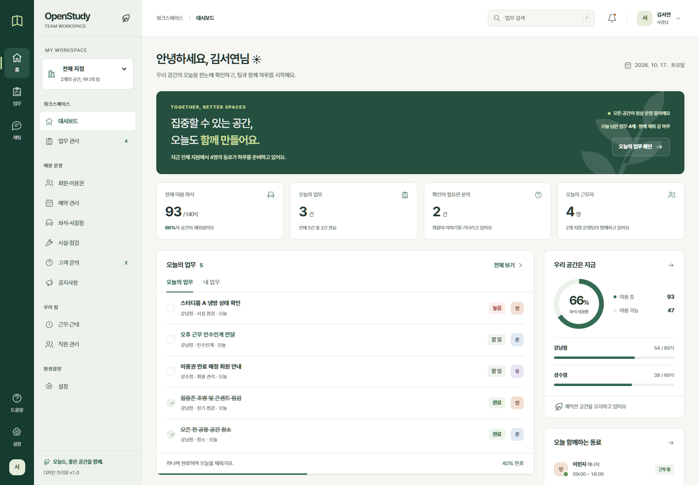
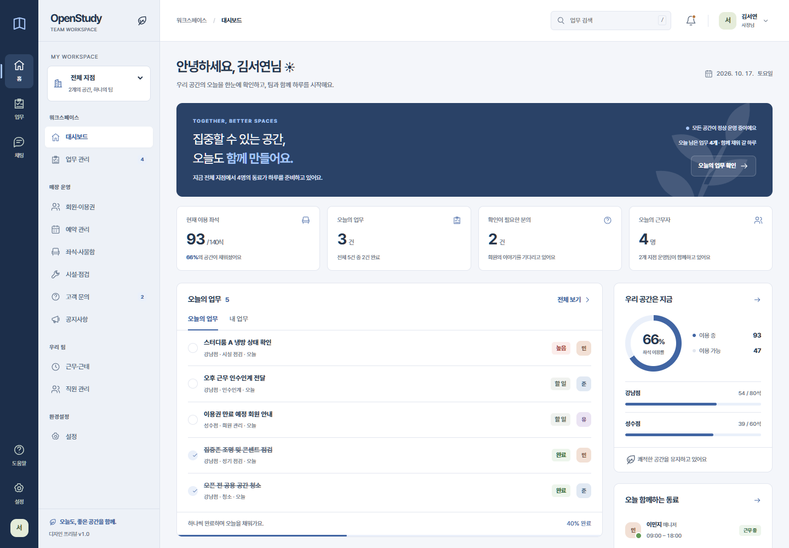
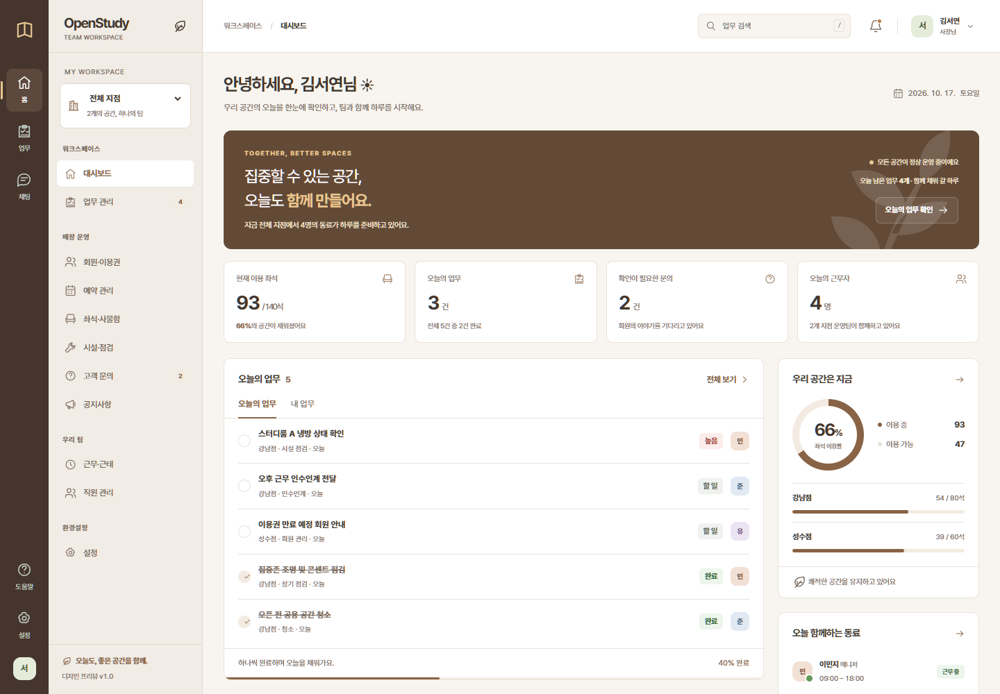

# OpenStudy · 팀 운영 워크스페이스 목업

스터디카페 사장님과 직원이 디자인과 업무 흐름을 비교할 수 있는 클릭형 HTML 목업입니다. PRD 수령 전의 디자인 검토용이며, 메뉴와 역할은 실제 서비스 요구사항으로 확정된 것이 아닙니다.

## 실행

**이 폴더의 `index.html`을 Chrome 또는 Edge에서 열면 됩니다.** 설치, 빌드, 서버, 인터넷 연결이 필요하지 않습니다. 세 파일(`styles.css`, `data.js`, `app.js`)을 HTML과 같은 폴더에 유지해 주세요.

로그인 화면의 **사장님으로 체험** 또는 **직원으로 체험**을 선택하세요. 일반 로그인은 이메일 형식과 빈 입력만 검사한 뒤 사장님 데모로 연결합니다. 실제 인증은 수행하지 않으며 비밀번호를 저장하지 않습니다.

## 먼저 체험할 흐름

1. 사장님으로 로그인 → **업무** → **업무 등록**을 선택합니다.
2. `스터디룸 냉방 점검`, 강남점, 이민지, 기한과 체크리스트를 입력합니다.
3. 등록 후 상세창에서 **운영 채널에 공유**를 선택합니다.
4. 오른쪽 위 사용자 메뉴에서 **직원**으로 전환합니다.
5. 공유된 업무 카드 아래 **답글 달기**에서 처리 결과를 남깁니다.
6. 업무 카드를 열어 체크리스트를 확인하고 **완료하기**를 선택합니다.
7. 채팅 카드, 업무 목록, 홈의 업무 집계와 최근 업무 공유에 변경이 함께 반영되는지 확인합니다.

## 화면과 동작

| 화면 | 제공하는 체험 |
| --- | --- |
| 로그인 | 입력 오류, 비밀번호 표시, 두 역할 데모 진입, 테마 선택 |
| 대시보드 | 지점별 운영·좌석·업무 집계, 오늘의 업무·내 업무, 근무자, 점검, 최근 업무 공유와 공지 |
| 업무 관리 | 제목·분류 검색, 담당자·상태·기한 필터, 내 업무, 등록, 담당자 변경, 체크리스트, 완료, 채팅 공유 |
| 팀 채팅 | 채널·DM 전환, 메시지 전송, 답글 스레드, 업무 카드 첨부, 채널 정보와 읽지 않은 표시 |
| 회원·이용권 | 회원 검색·상태 필터, 만료 예정·잔여 이용과 상세 |
| 예약 관리 | 2026년 10월 캘린더·목록, 날짜·상태 필터, 예약 상세 |
| 좌석·사물함 | 지점·구역 전환, 대표 좌석 배치, 상태별 좌석 상세, 스터디룸과 사물함 배정 |
| 시설·점검 | 검색·필터, 점검 상세, 담당자·처리 상태 변경 |
| 고객 문의 | 검색·필터, 상세, 담당자·처리 상태 변경, 답변 저장 예시 |
| 공지사항 | 검색, 공지 작성·상세, 전체·지점 공개, 중요 공지 고정·해제 |
| 근무·근태 | 오늘 근무자, 주간 근무표, 출퇴근 상태 시뮬레이션과 기록 예시 |
| 직원 관리 | 사장님 전용 목록·검색·직원 상세 |
| 설정 | 테마, 내 프로필, 알림 토글, 사장님 전용 지점 정보 |

예약 생성·취소, 회원 등록·이용권 변경, 결제, 직원 초대·권한 변경, 파일 첨부, 채널 생성, 근무표 편집, 비밀번호 재설정은 안내 메시지로 범위를 명시합니다. 답변과 공지는 실제 고객이나 직원에게 발송되지 않습니다.

## 테마·역할·상태

- **포레스트:** 딥그린·아이보리. 기본 테마입니다.
- **네이비:** 네이비·쿨그레이.
- **샌드:** 브라운·웜베이지.

로그인 오른쪽 위의 색상 버튼 또는 **설정 → 화면 테마**에서 변경합니다. 화면을 다시 그리지 않고 공통 CSS 변수를 바꾸므로 입력 중인 내용도 유지됩니다. 선택한 테마만 `localStorage`의 `openstudy-theme`에 저장합니다. 저장소 접근이 제한된 브라우저에서는 현재 창에서만 적용합니다.

사장님은 전체·개별 지점과 직원 관리를 확인하고 업무를 배정합니다. 직원은 강남점의 내 업무를 우선 확인하며 직원 관리·지점 설정이 숨겨집니다. 사용자 메뉴에서 역할을 바꾸어도 등록한 업무와 메시지는 메모리 안에 유지됩니다. 직원 관리의 주소로 직접 접근해도 직원 역할에서는 홈으로 이동합니다. 이는 실제 보안·권한 구현을 대신하지 않습니다.

테마를 제외한 상태는 **새로고침하면 초기화**됩니다. 재접속하면 데모 로그인 화면이 표시됩니다. 채팅 초안은 화면 이동 중 메모리에서 유지되며 새로고침하면 지워집니다.

샘플 기준일은 **2026년 10월 17일**입니다. 새 메시지 작성 시간만 현재 한국 시간을 표시합니다. 좌석 통계는 지점 전체, 배치도는 각 구역 대표 32석의 예시입니다. 가상 회원 정보와 샘플 예약을 사용합니다.

## 반응형과 키보드

- 1100px 이상: 앱 레일·보조 사이드바·업무 화면을 함께 표시합니다.
- 641–1099px: 사이드바를 메뉴 버튼으로 엽니다.
- 640px 이하: 하단 홈·업무·채팅·설정 탐색, 서랍 메뉴, 전체 화면 상세·스레드를 사용합니다.
- 표·좌석도·캘린더는 해당 영역에서 가로로 스크롤합니다.
- `/`: PC 업무 검색에 포커스. `Enter`: 메시지 전송. `Shift + Enter`: 줄바꿈.
- `Esc`: 상세창·서랍 닫기. 상세창은 키보드 포커스를 내부에서 순환시킵니다.
- 본문 건너뛰기, 입력 레이블, 포커스 표시, 상태 텍스트, 동작 결과 안내와 모션 감소 설정을 지원합니다.

## 파일 구성

| 파일 | 역할 |
| --- | --- |
| `index.html` | 로컬 실행 진입점, 공통 다이얼로그·상태 알림 |
| `styles.css` | 세 테마 토큰, 공통 컴포넌트, 반응형 스타일 |
| `data.js` | 지점·직원·업무·채팅 등 고정 샘플 데이터 |
| `app.js` | 해시 탐색, 화면 렌더링, 공유 상태와 상호작용 |
| `qa.cjs` | 선택적으로 실행하는 Chrome/Playwright 브라우저 검증 |
| `previews/` | 테스트 입력을 포함하지 않은 기본 상태 미리보기 |

기존 상위 폴더의 OpenOffice 참고 HTML 3개는 수정하지 않았습니다. 외부 폰트·CDN·이미지·라이브러리 의존성이 없으며, 스터디카페 일러스트와 아이콘은 인라인 SVG입니다.

## 검증

시스템 Chrome과 별도 제공된 Playwright 환경에서 `node qa.cjs`를 실행할 수 있습니다. Playwright를 사용하려면 해당 패키지가 Node의 모듈 검색 경로에 있어야 합니다. Chrome 경로는 `CHROME_PATH` 환경 변수로 변경할 수 있습니다. 목업 실행 자체에는 이 도구가 필요하지 않습니다.

검증 결과와 화면 캡처는 무시 대상인 `qa-artifacts/`에 생성됩니다. 핵심 흐름, 입력 검증·HTML 이스케이프, 테마 저장과 색상 대비, 역할 전환과 메뉴 제한, 검색·필터·빈 상태, 상세창 포커스, 작성 중 내용 유지, 새로고침 초기화, 1440·1024·390px 전 화면과 콘솔 오류를 검사합니다.

실제 모바일 기기의 가상 키보드, 다른 브라우저 엔진, 스크린리더 음성 출력, 백엔드 연동은 검증 범위에 포함되지 않습니다.

## 미리보기

| 포레스트 | 네이비 | 샌드 |
| --- | --- | --- |
|  |  |  |

로그인과 채팅, 모바일 화면도 `previews/`에서 확인할 수 있습니다.
